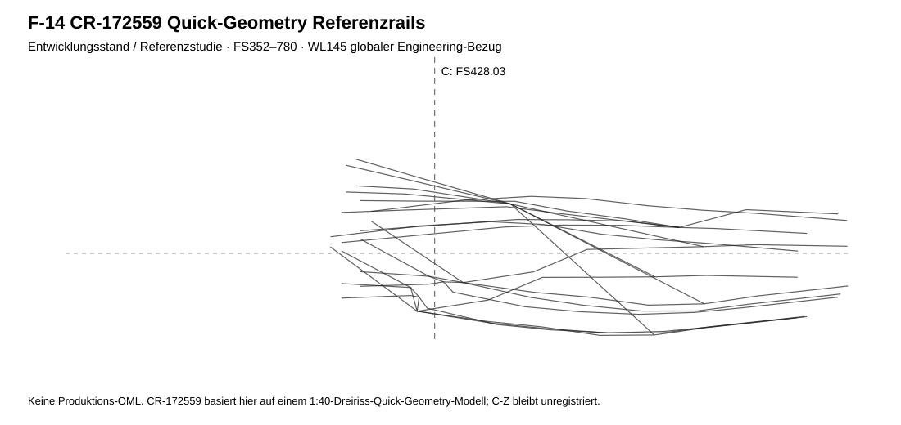

# 135er F-14 Tomcat RC

Neuaufbau des RC-/FDM-F-14-Projekts von Grund auf.

**Pilot / Projektkontext:** 135erHeli RC Pilot

## Aktueller sichtbarer FreeCAD-Entwicklungsstand

*FreeCAD-v194-Entwicklungsansicht vom 16. Oktober 2026. UPC-/Quellrumpf-Referenzhülle und Referenzhüllen sind ausgeblendet, damit die aktuell modellierten Zellenoberflächen, Einlauf-/EDF-Geometrie und Mechanik-Kandidaten sichtbar bleiben. Dies ist ein Entwicklungsstand, keine Druck- oder Flugfreigabe.*

Sobald ein neuer **sichtbarer und sinnvoll prüfbarer Entwicklungsstand** verfügbar ist, wird er im Repository dokumentiert und mit einem aktuellen Bild bzw. einer geeigneten Vorschau verknüpft. Zwischenstände werden klar als Entwicklung, Prototyp oder freigegebener Stand gekennzeichnet.

### Referenz-/Registrierungsstudie Sektion C – 20.10.2026

*Entwicklungsstand / Referenzstudie: Der neutrale C-Rasterkandidat ist einmal im historischen Kandidatenrahmen und einmal ausschließlich in Z auf die Mitte einer unabhängig interpolierten Seitenprojektionshülle verschoben dargestellt. Die Seitenhüllen-Guides sind keine bestätigte C-Stationskontur. Die dort gezeigte Z-Verschiebung ist inzwischen ausdrücklich nur noch als Diagnose eingestuft und keine Geometriekorrektur. Keine Master-, Druck-, Produktions- oder Flugfreigabe.*

### Navy/UPC-Seiten-X-Registrierung – 21.10.2026

*Entwicklungsstand / Referenzstudie: Drei homologe Seitenansichtslandmarken – FS93/Radomaufweitung, mittlerer Canopy-Bow und hinterster Nozzle-Endpunkt – stützen eine affine UPC-Seitenansichtsregistrierung auf Aircraft-Fuselage-Station. Nominaler Fit-RMS 0,185 Pixel; A-F können damit als Engineering-X-/FS-Kandidaten geführt werden. Die Z-/Waterline-Registrierung bleibt offen; keine Master-, Druck-, Produktions- oder Flugfreigabe.*

### A–F X-registrierte FreeCAD-Studie mit lokalem Z – 22.10.2026

*Entwicklungsstand / native FreeCAD-Studie: Die sechs Frontsektionen A–F stehen erstmals gemeinsam an den neuen Navy/UPC-basierten longitudinalen Engineering-X-Positionen. Jede Sektion wurde nur um ihre bisherige Kandidaten-Achse auf lokales Z=0 rezentriert; dieses lokale Z=0 ist ausdrücklich keine gemeinsame Aircraft-Waterline. Es wurde kein Loft erzeugt und der Master blieb unverändert. Keine Druck-, Produktions- oder Flugfreigabe.*

### CR-172559 Quick-Geometry-Referenzrails – 23.10.2026

*Entwicklungsstand / Referenzstudie: Native 3D-Referenzrails aus NASA CR-172559 fuer FS352–780. Sektion C liegt longitudinal bei FS428,03 im Segment Inlet → Nacelle Aft Fairing. Die CR-172559-Fuselage ist ein 1:40-Quick-Geometry-Modell und keine Produktions-OML; C-Z bleibt bewusst unregistriert.*

## Aktueller technischer Stand

Das Flugzeug ist weiterhin **unvollständig, nicht druckfertig und nicht für den Flug freigegeben**.

Noch offen sind unter anderem die belastbare durchgehende Rumpf-/Wing-Glove-Geometrie, die gemeinsame Baugruppenregistrierung, vermessene RC-Hardware, vollständige Strukturvalidierung und physische Nachweise. Eine Kollisions- oder Hüllprüfung gegen einen interpolierten Quellkandidaten ist kein Nachweis der originalen Außenkontur des Flugzeugs.

Zu den zuletzt ausgeführten Entwicklungsarbeiten gehören native verbundene Einlauf-/Adapterwände, interne Auslasskandidaten, ein internes Twin-EDF-Layout und lokale P2S-Slicing-Versuche. Die Auslassgeometrie besitzt zusätzlich eine ältere native parametrische Fusion-Historie mit sechs benannten Parametern; Reimport, Parameterregeneration und Kandidaten-Loft-Hüllprüfung wurden geprüft. STL-/3MF-Dateien bleiben ausdrücklich nicht freigegebene Entwicklungsartefakte.

Aktuell wird die Referenzgeometrie der F-14-Nase weiter abgesichert. Dazu gehören Navy-Stationsbezüge, UPC-/Maßstabsprüfungen sowie rekonstruierte Radom-Trennlinien aus Drauf- und Seitenansicht. Diese dienen derzeit als Referenzen und sind noch keine freigegebene 3D-Trennfuge oder Produktionsgeometrie.

- [Aktueller Stand Antrieb und offene Prüfschritte](docs/PROPULSION_CANDIDATE_STATUS_20261016.md)
- [Workflow zur Prüfung der Quellflügel](cad/fusion/source_review/README.md)
- [Verbindliches Massenbudget](docs/04_MASS_BUDGET.md)
- [Verifikationsplan](docs/05_DESIGN_VERIFICATION.md)
- [C-Achsschließung – neutraler Studienkandidat](docs/C_ACHSSCHLIESSUNG_STUDIENKANDIDAT_20261020.md)
- [A/B/C-Rahmenprüfung und aktueller C-Registrierungsblocker](docs/ABC_RAHMENPRUEFUNG_20261020.md)
- [Navy/UPC-Seiten-X-Registrierung und A-F-FS-Kandidaten](docs/SEITEN_X_REGISTRIERUNG_20261021.md)
- [Sektion C: Vertikaldatum bleibt gesperrt](docs/C_VERTIKALDATUM_PRUEFUNG_20261020.md)

## Konstruktionsziel

- optisch maßstabsgetreue Außenkontur der Grumman F-14 Tomcat
- 900 mm Spannweite bei 20° Flügelschwenkung
- Maßstab etwa 1:21,7
- zwei 50-mm-EDF
- 4S-LiPo
- funktionsfähige Schwenkflügel von 20° bis 68°
- vollbewegliche Höhenleitwerke
- FDM-orientierte Struktur für Bambu Lab P2S
- FreeCAD 1.1.4 als primäres Headless-Master-CAD
- Fusion nur für unvermeidbare Altbestandsprüfung oder Export, niemals für neue Konstruktion

## Nicht verhandelbare Regel

Die ausgemusterten Geometrien F14_RC_FDM R2/R3/R4 sowie deren OpenSCAD-, STL-/3MF-Dateien und Hardwareannahmen sind **keine Konstruktionsgrundlage** für dieses Projekt.

## Entwicklungsablauf

1. belastbare Originalreferenzgeometrie festlegen
2. Maßstab und Außenkontur festschreiben
3. Aerodynamik- und Schwerpunktbereich definieren
4. zentralen Flügelkasten und Schwenkmechanismus konstruieren
5. EDF, ESC, Akku und Elektronik integrieren
6. leichte FDM-Struktur und Carbonverstärkungen entwickeln
7. Masseneigenschaften prüfen
8. druckbare Module exportieren
9. Prüfstandtests durchführen
10. kontrollierte Flugerprobung schrittweise erweitern

## Dokumentation

- [Projektanforderungen](docs/00_PROJECT_REQUIREMENTS.md)
- [Referenzbasis](docs/01_REFERENCE_BASELINE.md)
- [RC-Vergleichsreferenzen](docs/02_RC_BENCHMARKS.md)
- [Systemarchitektur](docs/03_SYSTEM_ARCHITECTURE.md)
- [Massenbudget](docs/04_MASS_BUDGET.md)
- [Verifikationsplan](docs/05_DESIGN_VERIFICATION.md)

## CAD

FreeCAD 1.1.4 ist der aktive Headless-orientierte CAD-Workflow unter `migration/freecad`. Das ältere Fusion-Add-in unter `cad/fusion/F14TomcatRC` bleibt ausschließlich aus Gründen der Nachvollziehbarkeit und für unvermeidbare Altbestandsprüfung bzw. Export erhalten. Es darf nicht für neue F-14-Konstruktionsarbeit verwendet werden und wird nach solchen Altaufgaben wieder geschlossen.

## Sprache und sichtbare Projektstände

Das Repository wird ab jetzt **auf Deutsch geführt**. Neue README-Dateien, Statusberichte, Prüfdokumente und Beschreibungen werden deutsch erstellt. Technische Dateinamen, API-Bezeichner, Quellcode-Symbole und historisch notwendige Begriffe dürfen englisch bleiben, wenn eine Umbenennung die Nachvollziehbarkeit oder Funktion beeinträchtigen würde.

Sichtbare Entwicklungsstände werden möglichst früh im Repository abgelegt, sobald sie technisch sinnvoll beurteilt werden können. Dabei wird klar zwischen Referenz, Entwicklungsstand, Prototyp und Freigabestand unterschieden.

