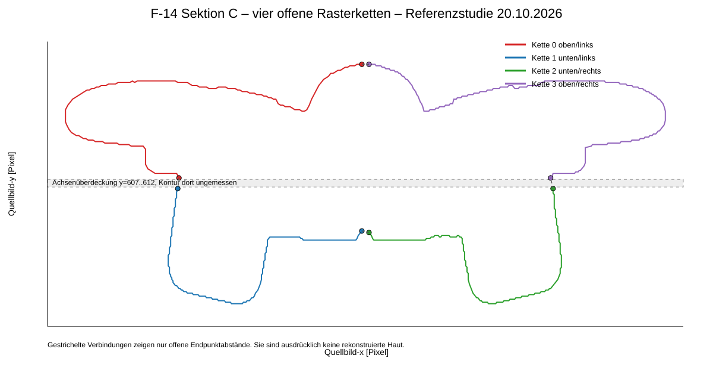

# Sektion C – Kontursemantik und Achsenokklusion – 20.10.2026

## Zweck
Sektion C enthält in der Originalzeichnung gleichzeitig Rumpf-/Glove-, Einlauf- und Achseninformationen. Deshalb dürfen sichtbare Rasterfragmente nicht automatisch als eine einzige geschlossene Stationshaut interpretiert werden.

*Referenzstudie: Die farbigen Linien sind vier separat konsolidierte, schnittfreie Rasterketten. Gestrichelte Verbindungen zeigen ausschließlich die Abstände offener Endpunkte. Sie sind keine rekonstruierte Haut.*

## Vier offene Ketten bei Schwellwert 128
- Kette 0, oben/links: 363 Punkte, Quellbereich x=817..1065, y=531..606.
- Kette 1, unten/links: 242 Punkte, Quellbereich x=903..1065, y=613..689.
- Kette 2, unten/rechts: 239 Punkte, Quellbereich x=1071..1232, y=613..689.
- Kette 3, oben/rechts: 357 Punkte, Quellbereich x=1071..1319, y=531..606.

Die vier Ketten besitzen keine nichtbenachbarten Selbstschnitte. Sie bleiben jedoch an vier Stellen offen.

## Verfeinerte Achsenokklusion
Die frühere Lückenkarte nannte für die äußeren Übergänge konservativ rund 15,264 Pixel zwischen weiter auseinanderliegenden Referenzpunkten. Die später separat erfassten Achseneckfragmente reichen näher an die überlagernde horizontale Achse heran.

Engste sichtbare Endpunkte:
- links: (912,606) → (911,613), Abstand 7,071 Pixel bzw. rund 3,239 mm im historischen C-Kandidatenmaßstab;
- rechts: (1223,606) → (1225,613), Abstand 7,280 Pixel bzw. rund 3,334 mm;
- obere Mittelachse: 6,000 Pixel bzw. rund 2,748 mm;
- untere Mittelachse: 6,083 Pixel bzw. rund 2,786 mm.

Die Quellzeilen 607..612 werden von der horizontalen Zeichnungsachse überlagert. Im Originalausschnitt ist eine Fortsetzung geometrisch plausibel, der eigentliche Konturverlauf in dieser Zone ist aber nicht messbar. Daher wird keine automatische Brücke erzeugt.

## Einlaufseiten
Die oberen und unteren äußeren Einlaufseiten schließen lokal an den Zeilen 649/650 mit nur 1 Pixel Abstand an. Das spricht für lokale Rasterkontinuität der äußeren Einlaufseite, beweist aber weder eine vollständige Stationshaut noch eine gemeinsame Wasserlinie.

Innere untere Einlaufseiten werden getrennt geführt und dürfen nicht mit der äußeren Haut vermischt werden.

## Konsequenz für die C-Registrierung
Die unabhängig interpolierte Seitenprojektionshülle darf nicht pauschal als obere und untere C-Stationskante verwendet werden. Zuerst muss bestimmt werden, welche sichtbaren C-Ketten tatsächlich dieselbe physische Außenhaut repräsentieren wie die jeweilige Seitenprojektion.

Bis dahin bleiben gesperrt:
- geschlossene C-Haut aus automatischen Achsenbrücken,
- A-B-C-Loft,
- Master-Änderung,
- Druck-, Produktions- oder Flugfreigabe.

## Nächster Schritt
Die vier offenen C-Ketten werden gegen die benachbarten B/C- und C/D-Seitenprojektionsverläufe sowie die Einlauf-/Glove-Semantik geprüft. Nur Kanten mit übereinstimmender physischer Bedeutung dürfen anschließend als Registrierungsanker dienen.
